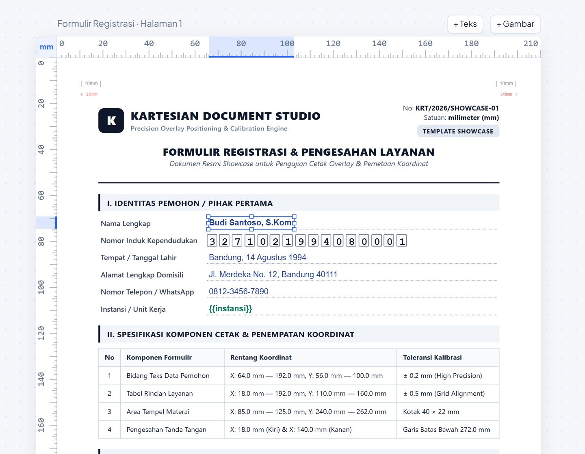

# Kartesian

[English](README.md) · **Bahasa Indonesia**

**Editor cetak koordinat di browser.** Kartesian menempatkan teks dan gambar di atas formulir pracetak atau PDF dengan ketelitian 0,1 mm. Susun layout sekali, isi untuk banyak dokumen, lalu cetak langsung dari browser. Tidak perlu server dan tidak perlu akun: semua data tersimpan di perangkat pengguna.



Antarmuka tersedia dalam Bahasa Indonesia dan English. Landing page ada di `/` (Indonesia) dan `/en/` (English), editor di `/editor/`.

## Daftar isi

- [Fitur](#fitur)
- [Cara kerja](#cara-kerja)
- [Mulai cepat](#mulai-cepat)
- [Script di package.json](#script-di-packagejson)
- [Menggunakan editor](#menggunakan-editor)
- [Format dokumen JSON](#format-dokumen-json)
- [Penyimpanan, privasi, dan offline](#penyimpanan-privasi-dan-offline)
- [Struktur proyek](#struktur-proyek)
- [Pengujian dan CI](#pengujian-dan-ci)
- [Deploy](#deploy)
- [Batas aplikasi](#batas-aplikasi)
- [Troubleshooting](#troubleshooting)
- [Dokumentasi lain](#dokumentasi-lain)
- [Lisensi](#lisensi)

## Fitur

- **Kertas apa saja.** A3, A4, A5, B5, F4 (210 × 330 mm), Letter, Legal, atau ukuran kustom 50–500 mm, potret maupun lanskap.
- **Presisi milimeter.** Koordinat dengan ketelitian 0,1 mm, penggaris interaktif, garis bantu, dan snapping magnetik.
- **Edit visual.** Drag, resize ke 8 arah, multi-seleksi dan seleksi marquee, rata dan distribusi, toolbar format mengambang, undo/redo hingga 50 langkah.
- **Satu layout, banyak dokumen.** Hingga 100 dokumen dengan layout yang sama, dan datanya bisa diedit langsung di panel JSON.
- **Panduan PDF dan deteksi field.** Unggah PDF formulir sebagai latar. Field (AcroForm, tabel key-value, kotak, garis isian) dideteksi otomatis dan bisa diterapkan sebagai placeholder seperti `{{nama}}`.
- **Kalibrasi printer.** Offset X/Y hingga ±50 mm untuk mengoreksi pergeseran printer.
- **Cetak dan ekspor.** Cetak langsung dari browser, atau ekspor ke file HTML mandiri.
- **Offline dan bisa dipasang.** PWA dengan precache otomatis. Setelah dibuka sekali, editor tetap berjalan tanpa internet.
- **Gabung data CSV.** Satu template, satu dokumen per baris CSV: setiap `{{key}}` diisi dari kolomnya, dengan format seperti `{{nominal|rupiah}}`, `{{nominal|words}}` (terbilang), dan `{{tanggal|date:dd MMMM yyyy}}`.
- **Tata letak teks formulir.** Perataan, jarak huruf, tinggi baris, perkecil agar muat, dan kotak per karakter (comb) untuk NIK atau kode.
- **Tanda, garis, kotak penutup, barcode, dan QR.** Centang dan silang untuk kotak pilihan, garis coret, kotak putih untuk menutup teks pracetak, barcode Code 128 / EAN-13, dan kode QR, semuanya bisa berisi placeholder.
- **Copy/paste, grup, dan layer.** Salin elemen antar halaman, dokumen, dan tab; kelompokkan elemen agar bergerak bersama; atur urutan, kunci, atau sembunyikan sementara di panel layer.
- **Zoom pas, grid, dan satuan.** Pas lebar atau pas halaman, grid 1–10 mm dengan snap, serta penggaris dan posisi dalam milimeter, inci, atau poin.
- **Cetak sebagian dan PDF native.** Cetak atau ekspor hanya dokumen/halaman tertentu, dan ekspor PDF vektor berukuran kertas persis tanpa dialog cetak browser.
- **Beberapa workspace dan template.** Simpan workspace terpisah untuk formulir berbeda, berpindah di antaranya, dan simpan template untuk dipakai ulang.
- **Dwibahasa.** Indonesia (default) dan English, dengan tombol ID/EN di editor.

## Cara kerja

Kartesian adalah aplikasi **local-first** yang di-build sebagai **static export Next.js** (`output: 'export'`). Hasil build di `out/` hanya berisi HTML, JavaScript, CSS, dan aset, tanpa API maupun database.

- Dokumen, aset gambar, PDF, dan pengaturan tersimpan di **IndexedDB** browser.
- Hanya satu tab yang boleh menulis ke workspace. Tab lain otomatis hanya-baca, supaya data tidak saling menimpa.
- Deteksi field berjalan di browser (PDF.js). Service Python opsional (PyMuPDF/PaddleOCR) berjalan di `127.0.0.1`, bukan di cloud.

Teknologi: Next.js 16 (App Router), React 19, TypeScript strict, Zustand, Zod, Tailwind CSS v4, PDF.js, Vitest, dan Playwright.

## Mulai cepat

### Prasyarat

- **Node.js 24**
- **pnpm 12.** Versinya dikunci di field `packageManager` pada `package.json`. Jalankan `corepack enable` sekali, dan Corepack akan memakai versi yang tepat.
- **Python 3.10–3.12** (opsional), hanya untuk service detector lokal.

### Instalasi dan pengembangan

```bash
git clone https://github.com/ChernobylCat/Kartesian.git
cd Kartesian
corepack enable
pnpm install
pnpm dev
```

Buka [http://localhost:3000](http://localhost:3000) untuk landing page, atau [http://localhost:3000/editor/](http://localhost:3000/editor/) untuk editor.

### Build produksi

```bash
pnpm build
pnpm start
```

Buka [http://127.0.0.1:4174/editor/](http://127.0.0.1:4174/editor/). Service worker, mode offline, dan CSP hanya aktif di build produksi. Uji di sini bila menyentuh hal-hal tersebut.

## Script di package.json

Semua script dijalankan dengan `pnpm run <nama>`. Untuk `dev`, `build`, `start`, dan `test`, cukup `pnpm <nama>`.

### Ringkasan

| Script                 | Fungsi singkat                                 |
| ---------------------- | ---------------------------------------------- |
| `dev`                  | Server pengembangan di port 3000               |
| `build`                | Build produksi ke `out/`                       |
| `start`                | Menyajikan `out/` di port 4174                 |
| `docker:build`         | Build image container                          |
| `docker:run`           | Menjalankan image di port 8080                 |
| `lint`                 | ESLint untuk `src/`                            |
| `typecheck`            | Pemeriksaan tipe TypeScript                    |
| `format`               | Prettier untuk seluruh repo                    |
| `format:check`         | Mengecek format tanpa mengubah file            |
| `format:src`           | Prettier untuk source, test, dan script saja   |
| `benchmark`            | Mengukur performa build produksi               |
| `test:unit`            | Test unit dan komponen (Vitest)                |
| `test:e2e`             | Test browser (Playwright)                      |
| `test`                 | `test:unit` lalu `test:e2e`                    |
| `check`                | Quality gate lengkap                           |
| `test:signing`         | Test kebijakan konfigurasi signing             |
| `test:detector`        | Test helper detector Python                    |
| `detector:install`     | Memasang detector PyMuPDF                      |
| `detector:install:ocr` | Memasang detector PyMuPDF dan PaddleOCR        |
| `detector:start`       | Menjalankan detector di `127.0.0.1:8765`       |
| `record:showcase`      | Merekam video demo editor                      |
| `generate:showcase`    | Membuat ulang PDF dan gambar formulir showcase |
| `capture:landing`      | Membuat ulang screenshot di landing page       |
| `audit`                | Audit kerentanan dependensi                    |

### Pengembangan dan build

**`dev`** menjalankan `node scripts/build/prepare-next.cjs && next dev --webpack`.

`prepare-next.cjs` menyalin aset yang dibutuhkan aplikasi ke `public/`. Asetnya: ikon, formulir showcase, dan screenshot landing dari `assets/`, worker serta cmaps PDF.js, Ace Editor, font Plus Jakarta Sans, dan lisensinya dari `node_modules/`. Setelah itu Next berjalan dalam mode pengembangan di port 3000 dengan hot reload. Service worker sengaja tidak aktif di mode ini.

**`build`** menjalankan `prepare-next.cjs`, lalu `next build --webpack`, lalu `scripts/build/build-offline.cjs`.

1. `prepare-next.cjs` mengisi `public/`.
2. `next build` memeriksa tipe dan menghasilkan static export di `out/`.
3. `build-offline.cjs` membuat `out/sw.js` dengan daftar precache dan versi berbasis hash isi file. Script ini juga menghitung hash CSP untuk inline script, lalu menulis header keamanan ke `out/_headers` (format Netlify/Cloudflare) dan `out/security-headers.json`.

Build butuh internet karena `next build` memeriksa advisory keamanan versi Next.

**`start`** menjalankan `node scripts/build/serve-next.cjs`, yaitu server statis untuk `out/`, jadi jalankan `build` dulu. Default-nya `http://127.0.0.1:4174`, dan bisa diubah dengan env `PORT` dan `HOST`. Server ini memasang header keamanan dari `security-headers.json` (plus HSTS di balik HTTPS), mengompres respons dengan brotli/gzip, dan mengatur cache:

- file `_next/static/` disimpan setahun;
- `sw.js` dan halaman lain divalidasi ulang lewat ETag;
- path yang tidak ada dijawab dengan `404.html`.

Server yang sama dipakai oleh test E2E dan container produksi.

**`docker:build`** menjalankan `docker build -t kartesian .`, yaitu membangun image dari `Dockerfile`. Tahap pertama memasang dependensi dengan pnpm dan menjalankan `pnpm run build`. Tahap kedua hanya berisi Node, `out/`, dan `serve-next.cjs`. Butuh Docker.

**`docker:run`** menjalankan `docker run --rm -p 8080:8080 kartesian`, yaitu image tadi di [http://localhost:8080](http://localhost:8080), dengan cara yang sama seperti di Cloud Run.

### Kualitas kode

**`lint`** menjalankan `eslint src --ext .ts,.tsx` dengan aturan `eslint-config-next` (React, hooks, Next) untuk kode di `src/`.

**`typecheck`** menjalankan `next typegen && tsc --noEmit`. `next typegen` membuat tipe rute Next lebih dulu, lalu TypeScript memeriksa seluruh `src/` dalam mode strict tanpa menghasilkan file.

**`format`** menjalankan `prettier --write .`, yaitu merapikan format seluruh repo kecuali yang tercantum di `.prettierignore`.

**`format:check`** menjalankan `prettier --check .`. Sama seperti `format`, tetapi hanya melaporkan file yang belum rapi, tanpa mengubahnya.

**`format:src`** menjalankan Prettier hanya untuk `src/`, `tests/`, dan `scripts/`. Pakai script ini bila tidak ingin menyentuh dokumen Markdown.

**`benchmark`** menjalankan `node scripts/tools/benchmark-next.cjs` terhadap build produksi, jadi jalankan `build` dulu. Script ini mengukur dataset D1–D4 (dari dokumen kecil sampai 100 dokumen × 100 halaman), interval frame saat drag, dan penggunaan heap saat PDF dibuka dan dihapus berulang kali. Secara lokal ia memakai Microsoft Edge, dan Chromium di CI. Hasilnya ditulis ke `test-results/next-performance.json`.

### Pengujian

**`test:unit`** menjalankan `vitest run` untuk `tests/unit/` (domain, penyimpanan, deteksi field, i18n, ukuran kertas) dan `tests/component/` (komponen React).

**`test:e2e`** menjalankan `playwright test` untuk `tests/e2e/` terhadap build produksi, jadi jalankan `build` dulu. Playwright menyalakan `serve-next.cjs` di port 4174 secara otomatis, atau memakai server yang sudah berjalan.

- Tanpa pengaturan apa pun, test berjalan di Chromium, Firefox, dan WebKit. Secara lokal, Chromium memakai Microsoft Edge yang terpasang.
- Pilih satu engine dengan `PW_BROWSER=chromium|firefox|webkit`.
- Port bisa diganti dengan `KARTESIAN_TEST_PORT`.
- Laporan HTML-nya ada di `playwright-report/`, dan trace atau screenshot kegagalan di `test-results/`.

**`test`** menjalankan `test:unit` lalu `test:e2e`.

**`check`** adalah quality gate lengkap, berurutan: `lint`, `typecheck`, `test:unit`, `test:signing`, `build`, `test:e2e`, dan `test:detector`. Jalankan sebelum membuat pull request.

**`test:signing`** menjalankan `node --test tests/signing/signing-config.test.cjs`. Test ini memeriksa aturan validasi konfigurasi lingkungan untuk fitur tanda tangan elektronik yang masih direncanakan (`scripts/tools/check-signing-config.cjs`, template di `infra/signing/`).

**`test:detector`** menjalankan `python -m unittest` untuk `services/pdf-field-detector/`. Test yang butuh PyMuPDF dilewati bila library itu belum terpasang.

### Detector PDF lokal (opsional)

**`detector:install`** menjalankan `python scripts/tools/install-detector.py`, yang memasang `services/pdf-field-detector/requirements.txt` (PyMuPDF) ke environment Python yang aktif. Script ini menolak Python di bawah 3.10. Gunakan virtual environment.

**`detector:install:ocr`** memasang `requirements-ocr.txt` (PyMuPDF dan PaddleOCR) untuk PDF hasil scan yang tidak punya lapisan teks. Membutuhkan Python 3.10–3.12, karena PaddlePaddle belum menyediakan wheel untuk 3.13 ke atas. Model OCR diunduh saat pertama kali dipakai.

**`detector:start`** menjalankan `python services/pdf-field-detector/server.py`, yaitu service di `127.0.0.1:8765` dengan endpoint status di `/health`. Service hanya menerima origin localhost. Tambahkan origin lain lewat env `KARTESIAN_ALLOWED_ORIGINS` (dipisah koma).

### Alat bantu aset

**`record:showcase`** menjalankan `node scripts/tools/record-showcase.cjs`, yang merekam video demo editor (1920 × 1080) dengan Playwright. Server `pnpm dev` harus sudah berjalan di port 3000. Rekaman mentah disimpan di `videos/` (diabaikan git), lalu disalin ke `public/assets/kartesian-showcase.webm`.

**`generate:showcase`** menjalankan `node scripts/tools/generate-showcase.cjs`, yang merender ulang formulir panduan showcase menjadi `assets/doc_1/showcase.pdf` dan `showcase-1.png`. Formulir ini muncul sebagai pilihan "Dokumen showcase" di editor.

**`capture:landing`** menjalankan `node scripts/tools/capture-landing.cjs` setelah `build`. Script ini mengisi editor dengan data contoh, lalu mengambil screenshot terang dan gelap ke `assets/landing/`. Jalankan bila tampilan editor berubah, lalu `build` lagi.

### Keamanan

**`audit`** menjalankan `pnpm audit --audit-level high`. Perintah ini gagal bila ada dependensi dengan kerentanan tingkat tinggi atau kritis, dan juga dijalankan di CI.

## Menggunakan editor

1. **Pilih ukuran kertas** di atas kanvas. Tombol putar mengganti potret/lanskap, dan **Kustom…** menerima 50–500 mm per sisi. Koordinat elemen tidak berubah, jadi kertas yang lebih kecil ditolak selama masih ada elemen yang akan keluar dari kertas. Workspace lama terbuka sebagai F4.
2. **Siapkan data.** Tambahkan **Teks** atau **Gambar** (PNG/JPEG/WebP/GIF, maksimal 2 MB), klik dua kali area kosong untuk menambah teks di titik itu, atau edit **Data JSON** langsung. Selama JSON tidak valid, kanvas tetap menampilkan versi valid terakhir, dan cetak serta ekspor dinonaktifkan.
3. **Atur posisi.** Drag, tarik handle resize (`Shift` untuk rasio tetap, `Alt` untuk dari tengah), atau isi X/Y/lebar/tinggi di panel properti. Seleksi marquee dari kiri ke kanan memilih elemen yang tercakup penuh, dari kanan ke kiri memilih semua yang tersentuh.
4. **Pakai PDF sebagai panduan** (opsional). **Unggah PDF** (maksimal 25 MB dan 50 halaman), atur opacity, lalu pilih mesin pemindaian:
   - **Otomatis:** PDF.js dulu, lalu PyMuPDF untuk halaman yang belum ada hasilnya, lalu PaddleOCR untuk halaman tanpa teks.
   - **PDF.js saja:** sepenuhnya di browser.
   - **PyMuPDF** atau **PaddleOCR:** memaksa service lokal.

   **Tinjau** kandidat field, ubah label atau key-nya, lalu terapkan sebagai placeholder di halaman yang sama pada setiap dokumen. Penerapan ini bisa dibatalkan dengan satu kali undo.

5. **Kalibrasi printer.** Cetak halaman uji di kertas kosong, ukur penanda kalibrasi dari tepi kertas, lalu isi **Offset X/Y**. Contohnya, bila hasil cetak bergeser 2 mm ke kanan, isi X dengan `-2`.
6. **Cetak atau ekspor.** Di dialog cetak browser, pilih ukuran kertas yang sama dengan workspace, skala 100%, margin nol, dan matikan header/footer. **Ekspor HTML** menghasilkan satu file mandiri berisi semua halaman, dan **Ekspor PDF** menghasilkan PDF vektor berukuran kertas persis. Tombol filter di samping **Cetak** membatasi ketiganya ke dokumen tertentu atau rentang halaman seperti `1-3, 5` selama sesi berjalan.

### Alat lain

- **Gabung CSV** (sidebar): pilih dokumen template dan berkas CSV (pemisah koma, titik koma, atau tab; maksimal 5 MB). Nama kolom dicocokkan longgar dengan placeholder (`Nama Lengkap` mengisi `{{nama_lengkap}}`). Pratinjau tiap baris, lalu buat dokumennya; satu undo membatalkan gabungan. Format: `upper`, `lower`, `title`, `number`, `rupiah`, `words` (terbilang, mengikuti bahasa UI), dan `date:<pola>` dengan `d`, `dd`, `M`, `MM`, `MMM`, `MMMM`, `yy`, `yyyy`.
- **Menu Elemen**: tanda centang, silang, dan titik; garis horizontal, vertikal, dan coret; kotak penutup putih; barcode (Code 128 atau EAN-13); dan kode QR. Bentuk, arah, warna, tebal garis, isi, dan format diatur di panel properti. Kode yang isinya masih berisi `{{key}}` tampil sebagai kotak berlabel sampai digabung.
- **Workspace** (ikon folder di samping _Workspace aktif_): buat, buka, ganti nama, duplikat, dan hapus workspace; simpan workspace yang terbuka sebagai template; dan mulai workspace baru dari template. Berpindah workspace menyimpan workspace yang terbuka lalu memuat ulang editor. Workspace dan template disimpan di database lokal terpisah (`KartesianLibraryDB`).
- **Satuan tampilan** (di _Cetak, kalibrasi & penyimpanan_): milimeter, inci, atau poin untuk penggaris dan input posisi/ukuran. Data selalu disimpan dalam milimeter.
- **Font di PDF native.** Ekspor PDF memakai font standar PDF: Helvetica untuk Arial, Verdana, dan Plus Jakarta Sans; Times untuk Times New Roman dan Georgia; Courier untuk Courier New. Karakter yang tidak didukung font tersebut (misalnya ✓ yang diketik sebagai teks, atau huruf CJK) tercetak sebagai `?`; gunakan elemen tanda untuk centang. Cetak lewat browser tetap memakai font editor yang persis.

### Shortcut keyboard

| Shortcut                                       | Aksi                             |
| ---------------------------------------------- | -------------------------------- |
| `Ctrl/Cmd + Z`, `Ctrl + Y` / `Cmd + Shift + Z` | Undo, redo                       |
| Panah / `Shift` + panah                        | Geser 0,1 mm / 1 mm              |
| `Ctrl/Cmd + A`                                 | Pilih semua di halaman aktif     |
| `Ctrl/Cmd + D`                                 | Duplikasi                        |
| `Ctrl/Cmd + C` / `X` / `V`                     | Salin / potong / tempel elemen   |
| `Ctrl/Cmd + G` / `Ctrl/Cmd + Shift + G`        | Kelompokkan / pisahkan kelompok  |
| `Alt + L`                                      | Kunci / buka kunci posisi        |
| `Alt + A` / `H` / `D`                          | Rata kiri / tengah / kanan       |
| `Alt + W` / `V` / `S`                          | Rata atas / tengah / bawah       |
| `Alt + Shift + H` / `V`                        | Distribusi horizontal / vertikal |
| `Delete` / `Backspace`                         | Hapus elemen terpilih            |
| `Escape`                                       | Kosongkan seleksi                |
| `Ctrl/Cmd + P`                                 | Cetak                            |
| `F1` / `?`                                     | Bantuan                          |

Shortcut tidak aktif saat mengetik di input, editor JSON, atau saat mengedit teks langsung di kanvas.

## Format dokumen JSON

Root-nya adalah array dokumen. Setiap dokumen punya nama dan halaman berurutan, dan setiap halaman berisi item teks atau gambar. Semua dokumen memakai layout yang sama, sehingga satu file bisa berisi formulir yang sama untuk banyak orang.

```json
[
  {
    "title": "Contoh Nasabah",
    "pages": [
      {
        "page_number": 1,
        "items": [
          {
            "text": "Budi Santoso",
            "x": 25,
            "y": 40,
            "width": 60,
            "font_family": "Arial, sans-serif",
            "font_size": 10,
            "color": "#111827",
            "bold": true
          }
        ]
      }
    ]
  }
]
```

| Properti                      | Tipe                 | Keterangan                                                                                                              |
| ----------------------------- | -------------------- | ----------------------------------------------------------------------------------------------------------------------- |
| `type`                        | `"text"` / `"image"` | Default `text`                                                                                                          |
| `text`                        | string               | Isi teks, atau data URL base64 untuk gambar                                                                             |
| `x`, `y`                      | number               | Posisi dalam mm, harus berada di dalam kertas                                                                           |
| `width`, `height`             | number               | Opsional untuk teks, wajib untuk gambar                                                                                 |
| `font_family`                 | string               | Arial, Courier New, Times New Roman, Georgia, Verdana, atau Plus Jakarta Sans (nilai persis seperti yang dibuat editor) |
| `font_size`                   | number               | 4–72 pt                                                                                                                 |
| `color`, `bg_color`           | string               | Warna `#rrggbb`                                                                                                         |
| `bold`, `italic`, `underline` | boolean              | Format teks. Teks tebal secara default.                                                                                 |
| `rotation`                    | number               | −360 sampai 360 derajat                                                                                                 |
| `z_index`                     | integer              | −1000 sampai 1000                                                                                                       |
| `locked`                      | boolean              | Mengunci posisi dan ukuran                                                                                              |

- **Nama dokumen.** Dibaca dari `title`. File versi lama boleh memakai `name` atau `debitur`; keduanya tetap diterima (dengan prioritas `title`, `name`, `debitur`) dan diekspor kembali dengan key yang sama.
- **Ukuran kertas.** Tidak termasuk dalam JSON. Ukuran kertas disimpan bersama workspace.

## Penyimpanan, privasi, dan offline

- **IndexedDB** (`KartesianWorkspaceDB`) menyimpan dokumen, gambar, PDF beserta byte aslinya, kandidat field, kalibrasi, dan pengaturan.
- **localStorage** hanya menyimpan pilihan bahasa, tema, status tur pengenalan, dan settings format lama yang dimigrasikan otomatis ke IndexedDB.
- **Backup workspace lengkap** (di panel _Cetak, kalibrasi & penyimpanan_) berisi semua data di atas, dilengkapi checksum SHA-256. Unduh backup sebelum pindah browser, perangkat, atau domain, karena data browser terikat ke origin.
- Menghapus data situs di browser akan menghapus semua dokumen dan PDF.
- Service worker menyimpan aplikasi untuk penggunaan offline setelah kunjungan pertama. Fitur PWA dan offline butuh HTTPS atau `localhost`.
- Saat versi baru tersedia, editor menampilkan banner **Perbarui aplikasi**, dan semua tab menyimpan data sebelum beralih.

## Struktur proyek

```text
Kartesian/
├── src/
│   ├── app/                       Rute: landing (/ dan /en/), editor, manifest, halaman error
│   ├── domain/document/           Schema, codec JSON, command, geometri, ukuran kertas, history
│   ├── application/               Autosave, perpindahan antar tab, persiapan output
│   ├── infrastructure/            IndexedDB, mesin PDF, ekspor HTML, codec settings
│   ├── features/                  UI per fitur: editor, landing, pdf, print, settings
│   ├── components/ui/             Komponen UI bersama (dialog)
│   ├── i18n/                      Inti locale, hook React, kamus id/en
│   └── styles/                    Gaya global, kanvas, cetak, dan landing
├── tests/
│   ├── unit/                      Test domain dan aplikasi (Vitest)
│   ├── component/                 Test komponen React (Vitest)
│   ├── e2e/                       Test Playwright terhadap build produksi
│   ├── signing/                   Test kebijakan konfigurasi signing (node:test)
│   ├── fixtures/                  Contoh dokumen valid dan tidak valid
│   └── support/                   PDF sintetis untuk test
├── scripts/
│   ├── build/                     Dipakai build/start: aset, service worker, server statis
│   └── tools/                     Alat bantu: benchmark, screenshot, showcase, installer detector
├── services/pdf-field-detector/   Service deteksi field Python (opsional, lokal)
├── assets/                        Sumber ikon, formulir showcase, screenshot landing
├── public/                        Dibuat saat build; tidak di-commit
├── infra/signing/                 Template environment untuk fitur tanda tangan elektronik
├── docs/                          Panduan, arsitektur, riwayat, dan proposal
└── Dockerfile                     Image untuk Google Cloud Run
```

- **Kode `src/`** berlapis: `domain` tidak bergantung pada apa pun, `application` dan `infrastructure` memakai `domain`, dan `features` (UI) memakai semuanya.
- **Teks UI** ada di `src/i18n/messages/id.ts` (referensi) dan `en.ts`. Tambahkan key di `id.ts` dulu; TypeScript akan menolak build bila terjemahan English-nya belum ada.
- **Folder hasil generate** (`out/`, `.next/`, `public/`, `test-results/`, `playwright-report/`, `videos/`) diabaikan git.

## Pengujian dan CI

Sebelum membuat pull request, jalankan:

```bash
pnpm run check
```

GitHub Actions ([quality.yml](.github/workflows/quality.yml)) berjalan pada setiap push dan pull request, dengan Node 24 dan pnpm dari `packageManager`:

- **Job `quality`:** install dengan `--frozen-lockfile`, build, typecheck, lint, test unit, test signing, test detector, dan audit dependensi.
- **Job `e2e`:** suite Playwright di Chromium, Firefox, dan WebKit. Bila gagal, trace, screenshot, dan laporan HTML diunggah sebagai artifact.

## Deploy

Hasil `pnpm build` adalah situs statis, jadi bisa disajikan oleh hosting statis apa pun asalkan header keamanan dari `out/_headers` ikut dipasang. Proyek ini juga sudah siap untuk Google Cloud Run:

```bash
gcloud run deploy kartesian --source . --region asia-southeast2 --allow-unauthenticated --port 8080
```

Persiapan, domain sendiri, dan hal yang perlu diperhatikan ada di [Deploy ke Google Cloud Run](docs/guides/DEPLOY-CLOUD-RUN.md).

## Batas aplikasi

| Sumber daya           |              Batas |
| --------------------- | -----------------: |
| Dokumen per workspace |                100 |
| Halaman per dokumen   |                100 |
| Elemen per halaman    |              1.000 |
| Total elemen          |              5.000 |
| Ukuran kertas kustom  | 50–500 mm per sisi |
| Gambar                |               2 MB |
| PDF                   | 25 MB / 50 halaman |
| Render PDF            |     20 juta piksel |
| Impor settings lama   |               5 MB |
| Backup workspace      |             150 MB |
| Undo/redo             |         50 langkah |
| CSV untuk gabung data |               5 MB |

## Troubleshooting

- **Halaman kosong atau modul gagal dimuat.** Jalankan `pnpm build` lalu `pnpm start`, dan buka `/editor/` di `http://127.0.0.1:4174`. Editor butuh origin HTTP untuk storage dan worker. File HTML hasil ekspor bisa dibuka langsung dari disk.
- **Perubahan tidak muncul setelah update.** Klik banner **Perbarui aplikasi**. Saat pengembangan, ingat bahwa service worker hanya aktif di build produksi.
- **Workspace hanya-baca.** Editor sedang terbuka di tab lain. Klik **Ambil alih**, atau tutup tab tersebut.
- **Hasil cetak bergeser dari preview.** Pastikan ukuran kertas di dialog cetak sama dengan workspace, skala 100%, margin nol, dan header/footer mati. Setelah itu, koreksi sisanya dengan Offset X/Y.
- **Detector lokal tidak terdeteksi.** Pastikan `pnpm run detector:start` masih berjalan, lalu cek `http://127.0.0.1:8765/health`. PDF.js tetap bekerja tanpa detector.
- **Playwright tidak menemukan browser.** Jalankan `pnpm exec playwright install chromium`, atau biarkan `PW_BROWSER` kosong supaya Microsoft Edge yang terpasang yang dipakai.
- **Workspace bermasalah saat dibuka.** Halaman pemulihan menyediakan perbaikan otomatis, pemulihan dari backup, dan reset. Data tersimpan tidak dihapus kecuali Anda memilih reset.

## Dokumentasi lain

- [Indeks dokumentasi](docs/README.md)
- [Panduan operasional](docs/guides/NEXTJS-OPERATIONS.md): perintah, batas runtime, migrasi data, dan rollback
- [Deploy ke Google Cloud Run](docs/guides/DEPLOY-CLOUD-RUN.md)
- [Arsitektur rewrite Next.js](docs/architecture/NEXTJS-REWRITE-MASTERPLAN.md) dan [statusnya](docs/architecture/NEXTJS-REWRITE-STATUS.md)
- [Proposal tanda tangan elektronik](docs/proposals/e-signature/ELECTRONIC-SIGNATURE-MASTERPLAN.md): masih rancangan, belum aktif di aplikasi
- Kode SPA lama sebelum rewrite Next.js tersedia di branch `archive/legacy-baseline` dan tag `v1.0.0-legacy-final`

## Lisensi

Kartesian dirilis dengan [Apache License 2.0](LICENSE).

Perilaku cetak berbeda-beda antar browser, driver, sistem operasi, dan printer. Selalu verifikasi kalibrasi dengan cetakan uji sebelum dipakai untuk produksi.
