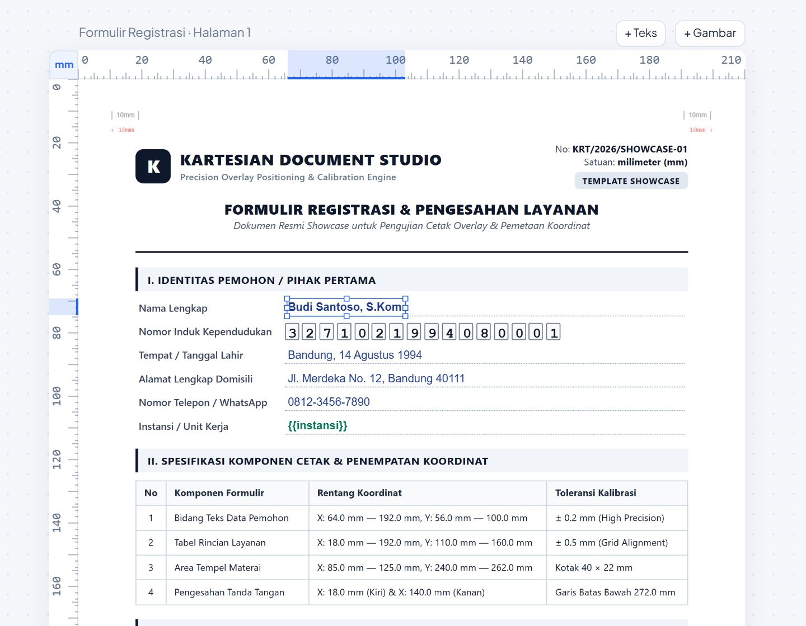

# Kartesian

**English** · [Bahasa Indonesia](README.id.md)

**A coordinate print editor in your browser.** Kartesian places text, images, barcodes, and QR codes on pre-printed forms or PDFs to within 0.1 mm. Lay a document out once, fill it for many records by hand or from a CSV file, then print straight from the browser or export a PDF. No server and no account: all data stays on the user's device.



The interface is available in Indonesian and English. The landing page is at `/` (Indonesian) and `/en/` (English), and the editor is at `/editor/`.

## Contents

- [Features](#features)
- [How it works](#how-it-works)
- [Getting started](#getting-started)
- [package.json scripts](#packagejson-scripts)
- [Using the editor](#using-the-editor)
- [JSON document format](#json-document-format)
- [Storage, privacy, and offline use](#storage-privacy-and-offline-use)
- [Project structure](#project-structure)
- [Testing and CI](#testing-and-ci)
- [Deployment](#deployment)
- [Limits](#limits)
- [Troubleshooting](#troubleshooting)
- [More documentation](#more-documentation)
- [License](#license)

## Features

- **Any paper size.** A3, A4, A5, B5, F4 (210 × 330 mm), Letter, Legal, or a custom size from 50 to 500 mm, in portrait or landscape.
- **Millimetre precision.** Coordinates to 0.1 mm, interactive rulers, guides, and magnetic snapping.
- **Visual editing.** Drag, resize from 8 handles, multi-select and marquee selection, align and distribute, a floating format toolbar, and up to 50 steps of undo/redo.
- **One layout, many documents.** Up to 100 documents share the same layout, and their data can be edited directly in the JSON panel.
- **PDF guides and field detection.** Upload a form as a PDF and use it as the background. Fields (AcroForm, key-value tables, boxes, fill-in lines) are detected automatically and can be applied as placeholders such as `{{name}}`.
- **Printer calibration.** X/Y offsets of up to ±50 mm correct printer drift.
- **Print and export.** Print from the browser, or export a standalone HTML file or a vector PDF at the exact paper size without the browser print dialog.
- **Offline and installable.** A PWA with automatic precaching. After the first visit, the editor keeps working without a connection.
- **CSV data merge.** One template, one document per CSV row: every `{{key}}` is filled from its column, with formats such as `{{amount|number}}`, `{{amount|words}}` and `{{date|date:MMMM d, yyyy}}`.
- **Form text layout.** Alignment, letter spacing, line height, shrink-to-fit, and character boxes (comb fields) for ID numbers and codes.
- **Marks, lines, cover boxes, barcodes and QR codes.** Ticks and crosses for checkboxes, strike-through lines, white boxes to cover pre-printed text, Code 128 / EAN-13 barcodes and QR codes, all of which can hold placeholders.
- **Copy and paste, groups and layers.** Copy elements between pages, documents and tabs; group elements to move them together; reorder, lock or temporarily hide them in the layers panel.
- **Fit zoom, grid and units.** Fit the page to the width or height, show a 1–10 mm grid with snapping, and show rulers and positions in millimetres, inches or points.
- **Partial print.** Print or export only some documents, or a page range such as `1-3, 5`.
- **Several workspaces and templates.** Keep separate workspaces for different forms, switch between them, and save reusable templates.
- **Bilingual.** Indonesian (default) and English, with an ID/EN switch in the editor.

## How it works

Kartesian is a **local-first** app built as a **Next.js static export** (`output: 'export'`). The build output in `out/` is plain HTML, JavaScript, CSS, and assets, with no API and no database.

- Documents, images, PDFs, and settings are stored in the browser's **IndexedDB**.
- Only one tab can write to the workspace at a time. Other tabs become read-only so they never overwrite each other.
- Field detection runs in the browser with PDF.js. An optional Python service (PyMuPDF/PaddleOCR) runs on `127.0.0.1`, not in the cloud.

Stack: Next.js 16 (App Router), React 19, strict TypeScript, Zustand, Zod, Tailwind CSS v4, PDF.js, pdf-lib, qrcode-generator, driver.js, Vitest, and Playwright.

## Getting started

### Requirements

- **Node.js 24**
- **pnpm 12.** The version is pinned in the `packageManager` field of `package.json`. Run `corepack enable` once and Corepack uses the right version.
- **Python 3.10–3.12** (optional), only for the local detector service.

### Install and develop

```bash
git clone https://github.com/ChernobylCat/Kartesian.git
cd Kartesian
corepack enable
pnpm install
pnpm dev
```

Open [http://localhost:3000](http://localhost:3000) for the landing page, or [http://localhost:3000/editor/](http://localhost:3000/editor/) for the editor.

### Production build

```bash
pnpm build
pnpm start
```

Open [http://127.0.0.1:4174/editor/](http://127.0.0.1:4174/editor/). The service worker, offline mode, and CSP are only active in the production build, so test there when you touch them.

## package.json scripts

Run any script with `pnpm run <name>`. For `dev`, `build`, `start`, and `test`, `pnpm <name>` is enough.

### Summary

| Script                 | What it does                                 |
| ---------------------- | -------------------------------------------- |
| `dev`                  | Development server on port 3000              |
| `build`                | Production build into `out/`                 |
| `start`                | Serves `out/` on port 4174                   |
| `docker:build`         | Builds the container image                   |
| `docker:run`           | Runs the image on port 8080                  |
| `lint`                 | ESLint for `src/`                            |
| `typecheck`            | TypeScript type check                        |
| `format`               | Prettier for the whole repository            |
| `format:check`         | Checks formatting without changing files     |
| `format:src`           | Prettier for source, tests, and scripts only |
| `benchmark`            | Measures performance of the production build |
| `test:unit`            | Unit and component tests (Vitest)            |
| `test:e2e`             | Browser tests (Playwright)                   |
| `test`                 | `test:unit`, then `test:e2e`                 |
| `check`                | Full quality gate                            |
| `test:signing`         | Signing configuration policy tests           |
| `test:detector`        | Python detector helper tests                 |
| `detector:install`     | Installs the PyMuPDF detector                |
| `detector:install:ocr` | Installs the PyMuPDF and PaddleOCR detector  |
| `detector:start`       | Starts the detector on `127.0.0.1:8765`      |
| `record:showcase`      | Records a demo video of the editor           |
| `generate:showcase`    | Regenerates the showcase form PDF and image  |
| `capture:landing`      | Regenerates the landing page screenshots     |
| `audit`                | Dependency vulnerability audit               |

### Development and build

**`dev`** runs `node scripts/build/prepare-next.cjs && next dev --webpack`.

`prepare-next.cjs` copies the assets the app needs into `public/`: icons, the showcase form, and landing screenshots from `assets/`, plus the PDF.js worker and cmaps, Ace Editor, the Plus Jakarta Sans font, and their licences from `node_modules/`. Next then runs in development mode on port 3000 with hot reload. The service worker is deliberately off in this mode.

**`build`** runs `prepare-next.cjs`, then `next build --webpack`, then `scripts/build/build-offline.cjs`:

1. `prepare-next.cjs` fills `public/`.
2. `next build` type-checks and writes the static export to `out/`.
3. `build-offline.cjs` creates `out/sw.js` with the precache list and a version based on a hash of the files. It also computes CSP hashes for inline scripts and writes the security headers to `out/_headers` (Netlify/Cloudflare format) and `out/security-headers.json`.

The build needs internet access because `next build` checks security advisories for the installed Next version.

**`start`** runs `node scripts/build/serve-next.cjs`, a static server for `out/`, so run `build` first. It listens on `http://127.0.0.1:4174` by default; change that with the `PORT` and `HOST` environment variables. The server applies the security headers from `security-headers.json` (plus HSTS behind HTTPS), compresses responses with brotli/gzip, and sets caching:

- files under `_next/static/` are cached for a year;
- `sw.js` and all other pages are revalidated with an ETag;
- unknown paths get `404.html`.

The same server is used by the E2E tests and the production container.

**`docker:build`** runs `docker build -t kartesian .` to build the image from the `Dockerfile`. The first stage installs dependencies with pnpm and runs `pnpm run build`. The second stage contains only Node, `out/`, and `serve-next.cjs`. Requires Docker.

**`docker:run`** runs `docker run --rm -p 8080:8080 kartesian`, which serves that image at [http://localhost:8080](http://localhost:8080) the same way Cloud Run does.

### Code quality

**`lint`** runs `eslint src --ext .ts,.tsx` with the `eslint-config-next` rules (React, hooks, Next) for the code in `src/`.

**`typecheck`** runs `next typegen && tsc --noEmit`. `next typegen` first generates the Next route types, then TypeScript checks all of `src/` in strict mode without emitting files.

**`format`** runs `prettier --write .` to format the whole repository except what `.prettierignore` lists.

**`format:check`** runs `prettier --check .`. Like `format`, but it only reports unformatted files and changes nothing.

**`format:src`** runs Prettier on `src/`, `tests/`, and `scripts/` only. Use it when you do not want to touch Markdown documents.

**`benchmark`** runs `node scripts/tools/benchmark-next.cjs` against the production build, so run `build` first. It measures datasets D1–D4 (from a small document up to 100 documents × 100 pages), frame intervals while dragging, and heap use while a PDF is opened and deleted repeatedly. It uses Microsoft Edge locally and Chromium in CI. Results are written to `test-results/next-performance.json`.

### Testing

**`test:unit`** runs `vitest run` on `tests/unit/` (domain, data merge, barcodes and QR, PDF export, storage, field detection, i18n, paper sizes) and `tests/component/` (React components).

**`test:e2e`** runs `playwright test` on `tests/e2e/` against the production build, so run `build` first. Playwright starts `serve-next.cjs` on port 4174 automatically, or reuses a server that is already running.

- By default, the tests run in Chromium, Firefox, and WebKit. Locally, Chromium uses the installed Microsoft Edge.
- Pick one engine with `PW_BROWSER=chromium|firefox|webkit`.
- Change the port with `KARTESIAN_TEST_PORT`.
- The HTML report is written to `playwright-report/`, and traces or screenshots of failures to `test-results/`.

**`test`** runs `test:unit`, then `test:e2e`.

**`check`** is the full quality gate, in order: `lint`, `typecheck`, `test:unit`, `test:signing`, `build`, `test:e2e`, and `test:detector`. Run it before opening a pull request.

**`test:signing`** runs `node --test tests/signing/signing-config.test.cjs`. It checks the environment configuration rules for the planned electronic-signature feature (`scripts/tools/check-signing-config.cjs`, with templates in `infra/signing/`).

**`test:detector`** runs `python -m unittest` on `services/pdf-field-detector/`. Tests that need PyMuPDF are skipped when it is not installed.

### Local PDF detector (optional)

**`detector:install`** runs `python scripts/tools/install-detector.py`, which installs `services/pdf-field-detector/requirements.txt` (PyMuPDF) into the active Python environment. It refuses Python versions below 3.10. Use a virtual environment.

**`detector:install:ocr`** installs `requirements-ocr.txt` (PyMuPDF and PaddleOCR) for scanned PDFs without a text layer. It needs Python 3.10–3.12, because PaddlePaddle does not yet ship wheels for 3.13 and later. The OCR models are downloaded on first use.

**`detector:start`** runs `python services/pdf-field-detector/server.py`, a service on `127.0.0.1:8765` with a status endpoint at `/health`. It only accepts localhost origins. Add other origins with the `KARTESIAN_ALLOWED_ORIGINS` environment variable (comma-separated).

### Asset tools

**`record:showcase`** runs `node scripts/tools/record-showcase.cjs`, which records a demo video of the editor (1920 × 1080) with Playwright. `pnpm dev` must already be running on port 3000. The raw recording goes to `videos/` (ignored by git) and is copied to `public/assets/kartesian-showcase.webm`.

**`generate:showcase`** runs `node scripts/tools/generate-showcase.cjs`, which re-renders the showcase guide form into `assets/doc_1/showcase.pdf` and `showcase-1.png`. This form is the "Showcase document" background option in the editor.

**`capture:landing`** runs `node scripts/tools/capture-landing.cjs` after a `build`. It fills the editor with sample data and takes light and dark screenshots into `assets/landing/`. Run it when the editor's look changes, then `build` again.

### Security

**`audit`** runs `pnpm audit --audit-level high`. It fails when a dependency has a high or critical vulnerability, and it also runs in CI.

## Using the editor

On the first visit, a short tour points out each step below. Reopen it, or the shorter **What's new** tour, from **Help** (`F1`).

1. **Choose the paper size** above the canvas. The rotate button switches between portrait and landscape, and **Custom…** accepts 50–500 mm per side. Element coordinates do not change, so a smaller sheet is refused while any element would fall outside it. Older workspaces open as F4.
2. **Add your data.** Add **Text** or an **Image** (PNG/JPEG/WebP/GIF, up to 2 MB), double-click an empty spot to add text there, or edit the **JSON data** directly. While the JSON is invalid, the canvas keeps showing the last valid version, and printing and export are disabled.
3. **Position elements.** Drag them, pull a resize handle (`Shift` keeps the ratio, `Alt` resizes from the centre), or type X/Y/width/height in the properties panel. A marquee dragged left to right selects elements fully inside it; dragged right to left, it selects everything it touches.
4. **Use a PDF as a guide** (optional). **Upload PDF** (up to 25 MB and 50 pages), set the opacity, and choose a scan engine:
   - **Automatic:** PDF.js first, then PyMuPDF for pages with no results, then PaddleOCR for pages without text.
   - **PDF.js only:** entirely in the browser.
   - **PyMuPDF** or **PaddleOCR:** forces the local service.

   **Review** the field candidates, rename their labels or keys, and apply them as placeholders on the same page of every document. Applying them can be undone with a single undo.

5. **Calibrate the printer.** Print a test page on blank paper, measure the calibration markers from the paper edges, and enter **Offset X/Y**. For example, if the print is 2 mm too far right, set X to `-2`.
6. **Print or export.** In the browser's print dialog, choose the same paper size as the workspace, 100% scale, no margins, and no headers or footers. **Export HTML** produces one standalone file with every page, and **Export PDF** a vector PDF at the exact paper size. The filter button next to **Print** limits all three to some documents or a page range such as `1-3, 5` for this session.

### More tools

- **Merge CSV** (sidebar): choose a template document and a CSV file (comma, semicolon or tab separated, up to 5 MB). Column names match placeholders loosely (`Full Name` fills `{{full_name}}`). Preview each row, then create the documents; one undo reverts the merge. Formats: `upper`, `lower`, `title`, `number`, `rupiah`, `words` (amount in words, in the UI language) and `date:<pattern>` with `d`, `dd`, `M`, `MM`, `MMM`, `MMMM`, `yy`, `yyyy`.
- **Element** menu: tick, cross and dot marks, horizontal, vertical and strike-through lines, a white cover box, a barcode (Code 128 or EAN-13) and a QR code. Their shape, direction, colour, stroke, value and format are in the properties panel. A code whose value still contains `{{key}}` shows as a labelled outline until it is merged.
- **Workspaces** (folder icon next to _Active workspace_): create, open, rename, duplicate and delete workspaces, save the open one as a template, and start a new workspace from a template. Switching saves the open workspace and reloads the editor. Workspaces and templates are kept in a separate local database (`KartesianLibraryDB`).
- **Display unit** (in _Print, calibration & storage_): millimetres, inches or points for rulers and position/size inputs. Data is always stored in millimetres.
- **Native PDF fonts.** PDF export uses the PDF standard fonts: Helvetica for Arial, Verdana and Plus Jakarta Sans, Times for Times New Roman and Georgia, and Courier for Courier New. Characters these fonts cannot encode (for example ✓ typed as text or CJK) print as `?`; use the mark element for ticks. Browser printing keeps the exact editor fonts.

### Keyboard shortcuts

| Shortcut                                       | Action                               |
| ---------------------------------------------- | ------------------------------------ |
| `Ctrl/Cmd + Z`, `Ctrl + Y` / `Cmd + Shift + Z` | Undo, redo                           |
| Arrow / `Shift` + arrow                        | Nudge 0.1 mm / 1 mm                  |
| `Ctrl/Cmd + A`                                 | Select everything on the active page |
| `Ctrl/Cmd + D`                                 | Duplicate                            |
| `Ctrl/Cmd + C` / `X` / `V`                     | Copy / cut / paste elements          |
| `Ctrl/Cmd + G` / `Ctrl/Cmd + Shift + G`        | Group / ungroup                      |
| `Alt + L`                                      | Lock / unlock position               |
| `Alt + A` / `H` / `D`                          | Align left / centre / right          |
| `Alt + W` / `V` / `S`                          | Align top / middle / bottom          |
| `Alt + Shift + H` / `V`                        | Distribute horizontally / vertically |
| `Delete` / `Backspace`                         | Delete the selected elements         |
| `Escape`                                       | Clear the selection                  |
| `Ctrl/Cmd + P`                                 | Print                                |
| `F1` / `?`                                     | Help                                 |

Shortcuts are ignored while typing in an input, in the JSON editor, or while editing text on the canvas.

## JSON document format

The root is an array of documents. Each document has a name and ordered pages, and each page holds items: text, images, and graphics (marks, lines, boxes, barcodes, and QR codes). All documents share the same layout, so one file can hold the same form filled in for many people.

```json
[
  {
    "title": "Sample Customer",
    "pages": [
      {
        "page_number": 1,
        "items": [
          {
            "text": "Jane Doe",
            "x": 25,
            "y": 40,
            "width": 60,
            "font_family": "Arial, sans-serif",
            "font_size": 10,
            "color": "#111827",
            "bold": true
          }
        ]
      }
    ]
  }
]
```

| Property                      | Type                              | Notes                                                                                                                                                                                                                     |
| ----------------------------- | --------------------------------- | ------------------------------------------------------------------------------------------------------------------------------------------------------------------------------------------------------------------------- |
| `type`                        | string                            | `text` (default), `image`, `mark`, `line`, `rect`, `barcode`, or `qr`                                                                                                                                                     |
| `text`                        | string                            | Text content; a base64 data URL for `image`; `check`, `cross`, or `dot` for `mark`; `horizontal`, `vertical`, `diagonal`, or `antidiagonal` for `line`; the value to encode (up to 500 characters) for `barcode` and `qr` |
| `x`, `y`                      | number                            | Position in mm; must be on the sheet                                                                                                                                                                                      |
| `width`, `height`             | number                            | Optional for text, required for every other type                                                                                                                                                                          |
| `font_family`                 | string                            | Arial, Courier New, Times New Roman, Georgia, Verdana, or Plus Jakarta Sans (exact values as written by the editor)                                                                                                       |
| `font_size`                   | number                            | 4–72 pt                                                                                                                                                                                                                   |
| `color`, `bg_color`           | string                            | `#rrggbb` colour. For `rect`, `bg_color` is the fill (white by default)                                                                                                                                                   |
| `bold`, `italic`, `underline` | boolean                           | Text formatting. Text is bold by default.                                                                                                                                                                                 |
| `rotation`                    | number                            | −360 to 360 degrees                                                                                                                                                                                                       |
| `z_index`                     | integer                           | −1000 to 1000                                                                                                                                                                                                             |
| `locked`                      | boolean                           | Locks position and size                                                                                                                                                                                                   |
| `text_align`                  | `"left"` / `"center"` / `"right"` | Text alignment within `width`                                                                                                                                                                                             |
| `letter_spacing`              | number                            | Extra space between characters, 0–50 mm                                                                                                                                                                                   |
| `line_height`                 | number                            | Multiple of the font size, 0.5–4                                                                                                                                                                                          |
| `comb_cells`                  | integer                           | 1–100 equal cells with one character each, for ID numbers; needs `width`                                                                                                                                                  |
| `fit`                         | `"shrink"`                        | Lowers the font size (down to 4 pt) until the text fits its box                                                                                                                                                           |
| `stroke_width`                | number                            | Line or border thickness of `mark`, `line` and `rect`, 0.05–20 mm                                                                                                                                                         |
| `barcode_format`              | `"code128"` / `"ean13"`           | For `barcode`; defaults to `code128`. EAN-13 takes 12 digits, or 13 with a valid check digit                                                                                                                              |
| `group_id`                    | string                            | Items with the same id are selected and moved together                                                                                                                                                                    |

- **Document name.** Read from `title`. Files from older versions may use `name` or `debitur` instead; both are still accepted (in the priority order `title`, `name`, `debitur`) and exported back under the same key.
- **Placeholders.** Text, barcode, and QR values can contain placeholders such as `{{name}}` or `{{amount|number}}`, which **Merge CSV** fills in.
- **Paper size.** Not part of the JSON. It is stored with the workspace.

## Storage, privacy, and offline use

- **IndexedDB** (`KartesianWorkspaceDB`) stores documents, images, PDFs with their original bytes, field candidates, calibration, and settings for the open workspace.
- **IndexedDB** (`KartesianLibraryDB`) stores the other saved workspaces and the templates.
- **localStorage** only holds the language choice, theme, onboarding state, grid size, display unit, and old-format settings, which are migrated to IndexedDB automatically.
- **Full workspace backup** (in the _Print, calibration & storage_ panel) contains the open workspace (documents, images, PDFs, calibration, and settings), with a SHA-256 checksum. Other saved workspaces and templates are not included, so open each workspace and back it up separately. Download one before moving to another browser, device, or domain, because browser data is tied to the origin.
- Clearing site data in the browser deletes all workspaces, templates, documents, and PDFs.
- After the first visit, the service worker keeps the app available offline. PWA install and offline use need HTTPS or `localhost`.
- When a new version is available, the editor shows an **Update app** banner, and every tab saves its data before switching.

## Project structure

```text
Kartesian/
├── src/
│   ├── app/                       Routes: landing (/ and /en/), editor, manifest, error pages
│   ├── domain/document/           Schema, JSON codec, commands, geometry, paper sizes, history,
│   │                              graphics, barcodes and QR, clipboard, units
│   ├── domain/merge/              CSV parser, placeholder formats, data merge
│   ├── application/               Autosave, cross-tab handover, output preparation, workspace library
│   ├── infrastructure/            IndexedDB, PDF engines, HTML and PDF export, settings codec
│   ├── features/                  UI by feature: editor, landing, merge, pdf, print, settings, workspaces
│   ├── components/ui/             Shared UI components (dialog)
│   ├── i18n/                      Locale core, React hooks, id/en dictionaries
│   └── styles/                    Global, canvas, print, and landing styles
├── tests/
│   ├── unit/                      Domain and application tests (Vitest)
│   ├── component/                 React component tests (Vitest)
│   ├── e2e/                       Playwright tests against the production build
│   ├── signing/                   Signing configuration policy tests (node:test)
│   ├── fixtures/                  Valid and invalid sample documents
│   └── support/                   Synthetic PDFs for tests
├── scripts/
│   ├── build/                     Used by build/start: assets, service worker, static server
│   └── tools/                     Tools: benchmark, screenshots, showcase, detector installer
├── services/pdf-field-detector/   Python field detection service (optional, local)
├── assets/                        Source icons, showcase form, landing screenshots
├── public/                        Generated at build time; not committed
├── infra/signing/                 Environment templates for the e-signature feature
├── docs/                          Guides, architecture, history, and proposals
└── Dockerfile                     Image for Google Cloud Run
```

- **`src/` is layered:** `domain` depends on nothing, `application` and `infrastructure` use `domain`, and `features` (the UI) uses all of them.
- **UI text** lives in `src/i18n/messages/id.ts` (the reference) and `en.ts`. Add new keys to `id.ts` first; TypeScript fails the build until the English translation exists.
- **Generated folders** (`out/`, `.next/`, `public/`, `test-results/`, `playwright-report/`, `videos/`) are ignored by git.

## Testing and CI

Before opening a pull request, run:

```bash
pnpm run check
```

GitHub Actions ([quality.yml](.github/workflows/quality.yml)) runs on every push and pull request, with Node 24 and the pnpm version from `packageManager`:

- **`quality` job:** install with `--frozen-lockfile`, build, typecheck, lint, unit tests, signing tests, detector tests, and the dependency audit.
- **`e2e` job:** the Playwright suite in Chromium, Firefox, and WebKit. On failure, traces, screenshots, and the HTML report are uploaded as artifacts.

## Deployment

`pnpm build` produces a static site, so any static host can serve it as long as it applies the security headers from `out/_headers`. The project is also ready for Google Cloud Run:

```bash
gcloud run deploy kartesian --source . --region asia-southeast2 --allow-unauthenticated --port 8080
```

Setup, custom domains, and things to watch out for are covered in the [Cloud Run deployment guide](docs/guides/DEPLOY-CLOUD-RUN.md) (in Indonesian). Pick the region closest to your users; `asia-southeast2` is Jakarta.

## Limits

| Resource                |              Limit |
| ----------------------- | -----------------: |
| Documents per workspace |                100 |
| Pages per document      |                100 |
| Elements per page       |              1,000 |
| Total elements          |              5,000 |
| Custom paper size       | 50–500 mm per side |
| Image                   |               2 MB |
| PDF                     |   25 MB / 50 pages |
| PDF rendering           |  20 million pixels |
| Legacy settings import  |               5 MB |
| Workspace backup        |             150 MB |
| Undo/redo               |           50 steps |
| CSV for data merge      |               5 MB |

## Troubleshooting

- **Blank page or modules fail to load.** Run `pnpm build`, then `pnpm start`, and open `/editor/` on `http://127.0.0.1:4174`. The editor needs an HTTP origin for storage and workers. Exported HTML files can be opened straight from disk.
- **Changes do not show after an update.** Click the **Update app** banner. During development, remember that the service worker only runs in the production build.
- **The workspace is read-only.** The editor is open in another tab. Click **Take over**, or close that tab.
- **The print is offset from the preview.** Make sure the print dialog uses the workspace paper size, 100% scale, no margins, and no headers or footers. Then correct what remains with Offset X/Y.
- **The local detector is not found.** Make sure `pnpm run detector:start` is still running, then check `http://127.0.0.1:8765/health`. PDF.js keeps working without the detector.
- **Playwright cannot find a browser.** Run `pnpm exec playwright install chromium`, or leave `PW_BROWSER` unset to use the installed Microsoft Edge.
- **The workspace fails to open.** The recovery page offers automatic repair, restore from backup, and reset. Stored data is not deleted unless you choose reset.

## More documentation

The documentation index and the operations guide are in English; the architecture notes, proposals, and the Cloud Run guide are in Indonesian.

- [Documentation index](docs/README.md)
- [Operations guide](docs/guides/NEXTJS-OPERATIONS.md): commands, runtime boundaries, data migration, and rollback
- [Cloud Run deployment guide](docs/guides/DEPLOY-CLOUD-RUN.md)
- [Next.js rewrite architecture](docs/architecture/NEXTJS-REWRITE-MASTERPLAN.md) and [its status](docs/architecture/NEXTJS-REWRITE-STATUS.md)
- [Electronic-signature proposal](docs/proposals/e-signature/ELECTRONIC-SIGNATURE-MASTERPLAN.md): still a draft, not active in the app

## License

Kartesian is released under the [Apache License 2.0](LICENSE).

Print behaviour varies across browsers, drivers, operating systems, and printers. Always verify the calibration with a test print before production use.
