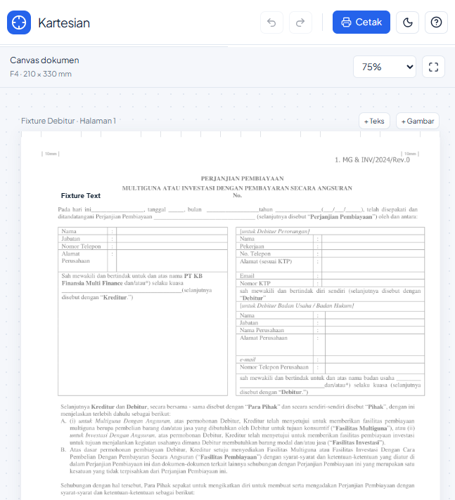

# Perbaikan akurasi background — 26 Oktober 2026

Background bawaan terdiri dari 9 PNG berukuran 1700 × 2600 px. Sebelumnya gambar dipaksa memenuhi kertas 210 × 330 mm pada kedua sumbu, sehingga proporsinya memanjang sekitar 2,75% secara vertikal. PNG tidak memiliki metadata DPI; ukuran fisik PDF aslinya tidak dapat disimpulkan dari aset ini.

Preview, cetak, dan HTML mandiri kini memakai `object-fit: contain` dengan posisi tengah. Ukuran kertas tetap 210 × 330 mm. Background bawaan tampil sebagai 210 × 321,176 mm, dengan ruang kosong sekitar 4,412 mm di atas dan bawah, tanpa pemotongan.

Koordinat kandidat PDF tersimpan tetap mengikuti kontrak lama yang dinormalisasi ke seluruh F4. Kotak kandidat, koordinat pada dialog review, dan placeholder yang diterapkan dipetakan ke area background proporsional menggunakan dimensi gambar halaman. Ini berlaku untuk hasil PDF.js, service lokal, dan kandidat tersimpan, termasuk halaman berotasi. Kandidat tidak ditransformasi ulang saat disimpan atau setelah reload.

Posisi elemen dokumen lama tetap dalam milimeter. Layout yang disusun berdasarkan background yang dahulu diregangkan perlu diperiksa kembali kesesuaiannya. Editor pemulihan `/legacy/` mempertahankan perilaku aslinya.

Validasi selesai:

- Build produksi Next.js beserta pemeriksaan TypeScript: lulus.
- ESLint: lulus.
- 27 tes unit/komponen: lulus, termasuk perhitungan fit dan pemetaan kandidat.
- 33 tes browser terpilih di Chromium, Firefox, dan WebKit: lulus. Mencakup background bawaan pada zoom 75%, PDF portrait A4, portrait sempit, landscape, persegi, rotasi, posisi field setelah reload/apply, cetak, HTML mandiri, backup, migrasi PDF, dan offline.
- Marker persegi pada PDF diverifikasi melalui piksel screenshot pada preview, cetak, dan HTML mandiri; toleransi perbedaan sisi 2 pixel. Preview pengukuran memakai zoom 50% agar seluruh halaman bebas dari tumpang tindih toolbar.
- Satu pengambilan ulang screenshot Chromium pada viewport 647 × 712: lulus.



Preview sesi ini berjalan di <http://127.0.0.1:4175/> karena port 4174 sedang dipakai server Vite proyek lain. Port 4175 memiliki penyimpanan origin tersendiri; workspace pada port 4174 tidak dipindahkan secara otomatis. Untuk memindahkan workspace gunakan backup lengkap dan pemulihan pada aplikasi.

Menjalankan preview dan pemeriksaan yang sama di PowerShell:

```powershell
$env:PORT = '4175'
npm start

$env:KARTESIAN_TEST_PORT = '4175'
npx playwright test -c playwright.next.config.cjs -g 'background|PDF worker|migrates original PDF|print geometry|portable HTML|offline cold'
```

Ukuran hasil cetak pada printer fisik dan kecocokan dengan PDF asli tetap memerlukan dokumen sumber serta kalibrasi printer.
