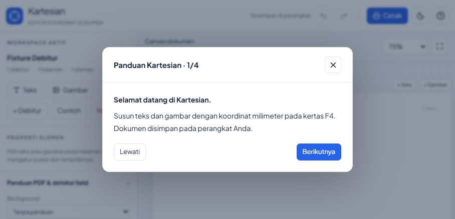
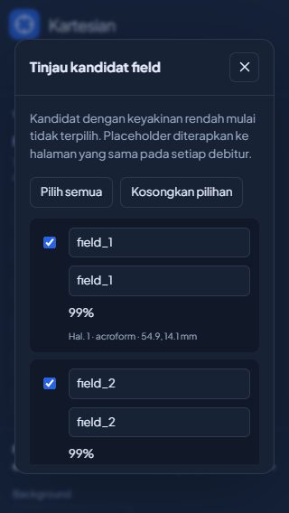

# Perbaikan dialog bersama — 26 Oktober 2026

Reset Tailwind mengatur margin semua elemen menjadi nol. Komponen dialog sebelumnya tidak mengembalikan margin otomatis bawaan browser, sehingga modal tampil di kiri atas.

Perbaikan diterapkan pada `src/components/ui/Dialog.tsx` dan aturan `.dialog` di `src/styles/globals.css`:

- Posisi tetap di tengah viewport menggunakan `inset: 0` dan `margin: auto`.
- Lebar dan tinggi dibatasi sesuai viewport, termasuk tinggi dinamis layar kecil.
- Header tidak menyusut; konten panjang bergulir pada body dialog sehingga tombol tutup tetap terlihat.
- Jarak judul, isi, dan tombol panduan diperjelas.
- Setiap instance memiliki ID judul aksesibel tersendiri melalui `useId`.
- Pada review PDF mobile, persentase kandidat sejajar dengan isian dan tidak terpecah ke kolom checkbox.

Seluruh pemakai komponen diperiksa: panduan awal empat langkah, Bantuan & shortcut, dan review kandidat field PDF. Konfirmasi serta prompt bawaan browser tidak memakai komponen ini.

Build produksi dengan pemeriksaan TypeScript, ESLint, dan 28 tes unit/komponen lulus. Matriks pengujian browser mencakup Chromium, Firefox, dan WebKit pada 1440 × 1000, 908 × 438, 320 × 568, serta 640 × 320, masing-masing dalam tema terang dan gelap. Pemeriksaan mencakup posisi tengah, batas viewport, overflow horizontal, header saat scroll, navigasi Tab/Shift+Tab, Escape, pengembalian fokus dari pembuka keyboard, serta penutupan lewat backdrop. Review panjang memakai fixture PDF form nyata berisi 20 field yang dipindai langsung oleh PDF.js, tanpa service lokal; pengujian alur PDF.js dan cetak existing juga dijalankan.

Preview pada <http://127.0.0.1:4175/> telah diaktifkan melalui alur pembaruan PWA. Stylesheet pada tab yang terbuka dicocokkan dengan build akhir, dan posisi dialog diverifikasi langsung pada viewport pengguna.

Hasil akhir: **30 dari 30 tes browser terpilih lulus**, mencakup 24 skenario dialog dan 6 regresi alur PDF/cetak. Ini merupakan pengujian terarah pada perubahan dialog, bukan pengulangan seluruh suite proyek.





```powershell
$env:KARTESIAN_TEST_PORT = '4175'
npx playwright test -c playwright.next.config.cjs -g 'shared dialogs|PDF worker|print geometry'
```
