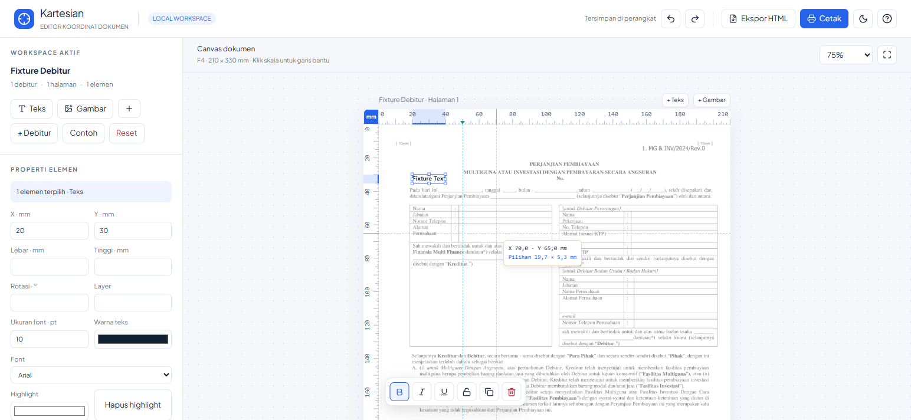
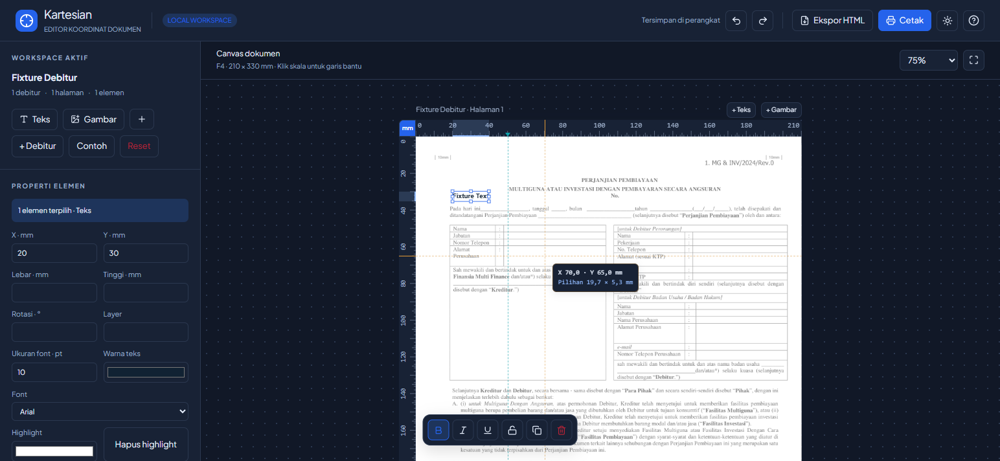

# Penggaris interaktif — 26 Oktober 2026

Penggaris membantu membaca posisi dan ukuran dalam koordinat milimeter dokumen F4. Strip dekoratif lama diganti dengan penggaris horizontal dan vertikal di luar kertas, angka 11 px, serta kepadatan label yang mengikuti zoom. Luas kertas tetap 210 × 330 mm.

Fungsi baru:

- Penanda dan garis silang mengikuti kursor; popup kecil menampilkan X/Y dan ukuran batas pilihan. Popup dibatasi agar tetap berada di dalam kertas. Tombol bidik mengaktifkan atau mematikan garis silang.
- Rentang pilihan ditandai pada kedua skala. Ukuran mengikuti teks, gambar, rotasi, multi-selection, drag, resize, dan marquee.
- Klik atau geser skala atas untuk memasang satu garis bantu vertikal; gunakan skala kiri untuk satu garis bantu horizontal. Magnetic snapping yang aktif turut memakai garis ini.
- Saat penggaris mendapat fokus: panah menggeser 1 mm, Shift + panah 10 mm, Alt + panah 0,1 mm, Home/End menuju ujung skala, dan Delete/Backspace/Escape menghapus garis pada sumbu itu. Klik dua kali skala juga menghapusnya. Tombol penghapus membersihkan kedua garis pada halaman tersebut.
- Mengeklik elemen mengembalikan fokus keyboard ke dokumen sehingga panah kembali menggeser elemen.

Garis bantu dan pilihan tampilan bidik berlaku selama sesi editor. Keduanya bertahan saat halaman divirtualisasi dan ketika halaman panduan mulai diisi. Penyimpanan menggunakan identitas logis debitur/nomor halaman; helper ini tidak menjadi konten JSON, backup, history dokumen, cetak, atau HTML mandiri. Pembacaan pointer dibulatkan ke 0,1 mm dan mengikuti resolusi piksel input browser; keyboard menyediakan langkah presisi untuk garis bantu.

Perhitungan batas pilihan berada di `src/domain/document/measurement.ts`. `CanvasRulers.tsx` menangani tampilan dan input penggaris; `useCanvasPointer.ts` meneruskan pratinjau gesture. Pointer memakai `requestAnimationFrame`, dan dimensi elemen diambil pada awal gesture untuk menghitung pratinjau tanpa membaca ulang semua kotak DOM setiap frame. Pilihan yang sudah dikomit diukur kembali dari DOM dan font yang sudah siap.

Validasi:

- Build produksi Next.js dengan TypeScript, ESLint, dan 38 tes unit/komponen: lulus.
- 33 tes browser terpilih di Chromium, Firefox, dan WebKit: lulus. Mencakup zoom 40/75/150%, label tanpa tumpang tindih, koordinat input aktual, batas popup, snap, keyboard/fokus, undo, virtualisasi/materialisasi, multi-selection, resize berotasi, PDF, cetak, serta HTML mandiri.
- Setelah penyesuaian warna tema gelap, tiga tes interaksi terkait dijalankan ulang pada ketiga browser: lulus. Kontras teks ukuran terhadap background popup memenuhi ambang pengujian 4,5:1. Ini pemeriksaan terarah, bukan audit aksesibilitas menyeluruh.
- Skala untuk seluruh pilihan zoom 40/50/65/75/100/125/150% dicakup tes unit.
- Preview pada <http://127.0.0.1:4175/> telah diperbarui melalui alur PWA dan diverifikasi langsung: fokus kembali ke elemen, angka berukuran 11 px, serta pembacaan ukuran aktif pada tema gelap.





```powershell
$env:KARTESIAN_TEST_PORT = '4175'
npx playwright test -c playwright.next.config.cjs -g 'rulers match|ruler guides|session guides|selection, drag|rotated resize|print geometry|large documents|PDF worker|marquee, multi'
```
